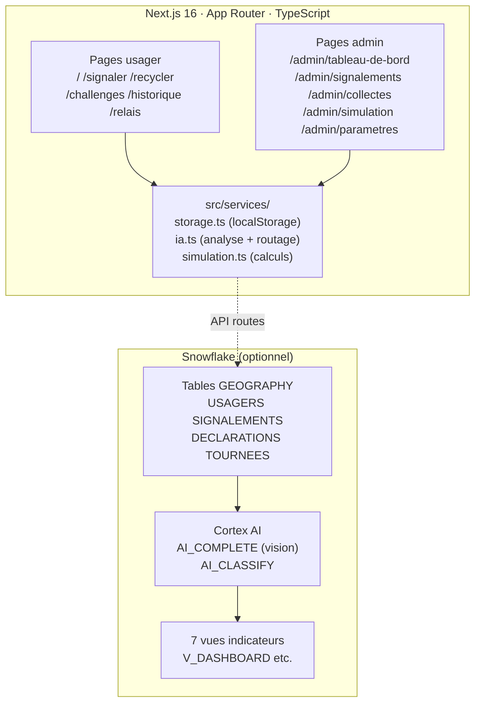

# EcoAbidjan

Signalement des dépôts sauvages et valorisation des déchets recyclables à Abidjan, propulsé par l'IA et Snowflake.

**Hack for Humanity – Abidjan 2026 · Sujet 1**

## Lancement rapide

```bash
npm install
npm run dev
# → http://localhost:3000
```

## Comptes de démo (code PIN : 1234)

| Rôle | Numéro |
|------|--------|
| Ménage – Aminata Koné (Abobo) | +225 07 00 00 00 01 |
| Commerçant – Ibrahim Bamba (Yopougon) | +225 07 00 00 00 02 |
| Point relais (Cocody) | +225 07 00 00 00 03 |
| Administrateur | +225 07 00 00 00 04 |

## 3 scénarios de démo

**Scénario 1 – Signalement** : `/signaler` → photo → analyse IA → notification admin (`/admin/signalements`)

**Scénario 2 – Commerçant gros volume** : connexion u002 → `/recycler` → déclarer > 50 kg → rémunération directe → visible dans `/admin/collectes`

**Scénario 3 – Ménage petit volume** : connexion u001 → `/recycler` → déclarer < 50 kg → QR code → `/relais` → scan ECO-4F7K2 → solde avant/après visible

## Snowflake

```bash
# Dans Snowflake Worksheets, exécuter dans l'ordre :
snowflake/01_tables.sql       # Schéma + stage SSE pour photos
snowflake/02_donnees_synthetiques.sql  # 500 ménages + 200 commerçants
snowflake/03_analyse_photos.sql        # AI_COMPLETE vision + AI_CLASSIFY
snowflake/04_indicateurs.sql           # 7 vues pour le tableau de bord
```

Créer un compte : **mlh.link/snowflake-signup** (accès gratuit 120 jours)

## Variables d'environnement

```bash
cp .env.example .env.local
# Remplir les credentials Snowflake (optionnel – démo fonctionne sans)
```

## Architecture



## Stack

- Next.js 16 + TypeScript + Tailwind CSS 4
- Lucide React (icônes), Recharts (graphiques), Leaflet/OSM (carte)
- qrcode.react (QR codes)
- Snowflake SDK (API routes serveur uniquement)
- Données : localStorage prérempli avec seed.ts
